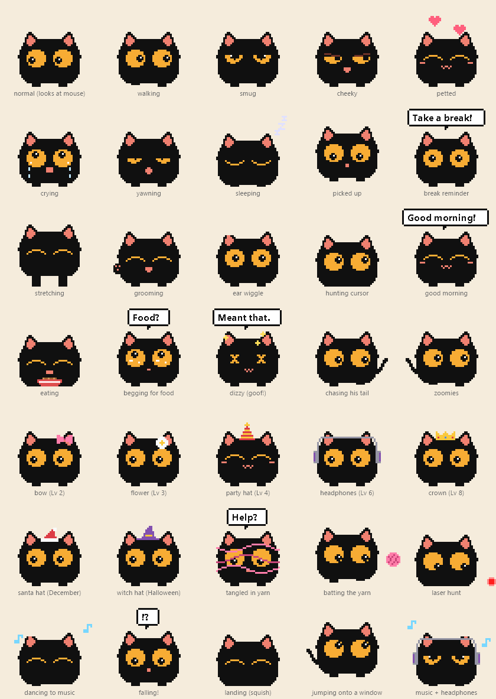

# YourPetKalo 🐈‍⬛

A tiny black pixel cat that lives on your Windows desktop. His name is **Abu Khaleel Bamblast** ("Abu").
He wanders around, naps, gets hungry, plays with yarn, chases your laser pointer, sits on top of your
windows, dances to your music, and is just a little bit silly. He does nothing useful on purpose. Mostly.



**Light on your PC:** about 10 MB of RAM and well under 1% of one CPU core. He redraws only when something
changes, slows down when resting, and hides himself while you play games or watch fullscreen video.

## Get it

**Download:** grab `CatPet.exe` from the [latest release](../../releases/latest) and double-click it.
No installer, no admin rights.

> Windows **Smart App Control** blocks apps that aren't code-signed, and CatPet isn't signed yet.
> If it's blocked, build it yourself (below) or turn Smart App Control off in
> Windows Security → App & browser control (read the warning: on many Windows versions it can't be turned back on).

**Build it yourself** (Windows 10/11, nothing to install – uses the C# compiler that ships with Windows):

```powershell
git clone https://github.com/<owner>/YourPetKalo.git
cd YourPetKalo
powershell -ExecutionPolicy Bypass -File .\build.ps1
.\CatPet.exe
```

### macOS (beta)

A native Swift version lives in [`mac/`](mac/) (macOS 12+, Apple Silicon and Intel).
Download `YourPetKalo-mac.zip` from the [latest release](../../releases/latest), unzip, and move
`YourPetKalo.app` to Applications. It isn't notarized by Apple yet, so the first time:
**right-click the app → Open → Open**.

Build it yourself on a Mac (needs Xcode or `xcode-select --install`):

```bash
bash mac/build.sh
open mac/build/YourPetKalo.app
```

The Mac version has everything except **dancing to music** (macOS doesn't let apps read the system
sound level without extra permissions). Window-sitting uses window positions only; it never reads
window titles or contents. It's newer and less tested than the Windows version — bug reports welcome!

## Playing with Abu

| Do this | He does |
|---|---|
| Click him | Gets petted: hearts, purr, happy face |
| Double-click | Hops |
| Drag him | Carries him. Shake him and he gets dizzy. Flick and let go: he gets thrown |
| Hover | Shows his name and the time |
| Right-click | Menu: Feed, Toys, Hat, Journal, Stay here, Follow my mouse, Gravity, Nap, Size, Mute, Break reminders, Start with Windows |

### What he does on his own
- **A tiny "dumbo brain":** picks what to do from his hunger, energy, fun and love, and learns what you like
  (pet him right after a trick and he'll do it more). About 15% of the time it goes wrong: he trips, misses
  pounces, bonks into the screen edge, forgets why he's walking, chases his tail until he's dizzy, stares at
  nothing and panics into the zoomies.
- **Needs:** gets hungry and begs ("Food?"), naps when tired, cries if nobody pets him for an hour.
- **Feeding:** Feed puts down a bowl; he runs over and eats it.
- **Toys:** a yarn ball you can throw (he bats it around and sometimes gets tangled) and a 1-minute laser pointer.
- **Bond levels 1–10:** earned by petting, feeding and playing. Unlocks hats: bow, flower, party hat,
  headphones, crown. Santa hat in December, witch hat at Halloween, party hat on his birthday.
- **Gravity:** falls, lands with a squish, sits on the top edges of your windows and rides along when you move them.
- **Dances** when music plays. **Hides** during games / fullscreen video.
- **Useful bits:** good morning / lunch / dinner / "it's late" messages, a break reminder after an hour of
  non-stop use, and a **Journal** window with his mood and the last 7 days.

His settings and memories are saved in `%APPDATA%\CatPet\` (Windows) or
`~/Library/Application Support/YourPetKalo/` (Mac).

## Project layout

```
src/        the app (C# 5, WinForms, .NET Framework 4 – compiles with Windows' built-in csc.exe)
  Program.cs   entry point, single instance
  Cat.cs       the cat window, state machine, menu
  Brain.cs     the silly needs-based brain (picks actions, goof chances)
  Needs.cs     needs, bond XP, settings + journal storage
  Art.cs       all pixel art (text grids) and drawing
  Sounds.cs    plays the meows; synthesizes purr, crunch, thump
  Prop.cs      small windows for the food bowl, yarn ball (physics) and laser dot
  Desktop.cs   window edges, fullscreen detection, audio level (Core Audio)
  Dialogs.cs   the Journal window
mac/        the macOS version (Swift + AppKit): Sources/*.swift, build.sh, Info.plist
sounds/     the meow sounds built into the apps, plus the source recording
tools/      make-sounds.ps1 turns sounds/source-meow.mp3 into soft meow WAVs
docs/       preview image
build.ps1   builds CatPet.exe
```

The pixel art is plain text: every letter in the grids in `Art.cs` is one pixel
(`K` fur, `O` eyes, `P` pink, ...). Change a grid, run `build.ps1`, and you've redrawn him.
`powershell -c "Add-Type -Path (gci src\*.cs) -ReferencedAssemblies System.Windows.Forms,System.Drawing; [CatPet.Art]::SavePreview('preview.png')"`
renders every pose to a PNG.

## Contributing

Contributions are very welcome — new tricks, hats, goofs, bug fixes, translations. See [CONTRIBUTING.md](CONTRIBUTING.md).

Planned next: focus (Pomodoro) timer, "remind me" notes, renaming the cat, and a second cat friend.

## Credits

- Code: MIT License, see [LICENSE](LICENSE).
- **Cat artwork:** Abu's look is based on black-cat pixel art by Xiaohongshu creator 6381064376,
  used with permission. The artwork design is **not** covered by the MIT license; please ask the
  original artist before reusing it in other projects.
- **Meow sound:** "Cat Meow 8 (FX)" by sound_garage, used with permission and softened for this project.
  The recording in `sounds/` is **not** covered by the MIT license.
